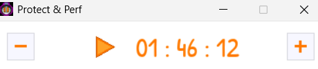

# Max_2_hours  - Pomodoro / Minuteur

<p align="center">
  
</p>

[](https://github.com/FromTheRags/Max_2_hours/actions/workflows/build.yml)
[](LICENSE)
[](https://www.libsdl.org/)
[](https://cmake.org/)

> [!NOTE]
> 🚀 **Vous recherchez une version moderne ?** Découvrez la branche [`SDL_3`](https://github.com/FromTheRags/Max_2_hours/tree/SDL_3) !
> Cette branche `main` préserve et remastérise le code d'origine de 2013 sous **SDL 1.2**, tandis que la branche [`SDL_3`](https://github.com/FromTheRags/Max_2_hours/tree/SDL_3) propose une implémentation native sous **SDL 3 & SDL3_ttf** avec accélération matérielle GPU et intégration multiplateforme moderne.

Un minuteur de session (2 heures) en C++ avec SDL 1.2 et SDL_ttf, initialement conçu pour limiter le temps d'écran et prévenir la fatigue visuelle.
**Le code a été entièrement remastérisé** : nettoyage des scripts obsolètes, portabilité multiplateforme C++17, assets 100 % libres de droits (GPLv3, SIL OFL 1.1 et CC0 1.0) et automatisation CI/CD moderne avec CMake.

---

## ✨ Fonctionnalités remastérisées

- **Titre de fenêtre lisible** : Dimensions de la fenêtre optimisées (360x60) pour assurer la visibilité complète du titre (« Protect & Perf - 2 Heures ») sans être masqué par les boutons de la barre de titre.
- **Minimisation dans le System Tray** :
  - Sous Windows, la minimisation masque la fenêtre et la loge discrètement dans la zone de notification (systray).
  - L'infobulle affiche le compte à rebours restant en direct lors du survol.
  - Menu contextuel (clic droit ou double-clic) pour restaurer, mettre en pause ou quitter.
- **Décompte de 2 heures** : affichage grand format du temps restant (`Temps: 02 : 00 : 00`) en orange sur fond blanc avec centrage automatique.
- **Pause / Reprise au clic** : un simple clic sur la fenêtre met le décompte en pause et affiche l'icône de lecture ; un second clic relance le chronomètre.
- **Rappel de sécurité à 5 minutes** : lorsque moins de 5 minutes restent au chronomètre, la fenêtre se restaure automatiquement depuis le systray et se place au premier plan (`HWND_TOPMOST` sous Windows).
- **Mise en veille prolongée automatique** : à la fin exacte des 2 heures de décompte, le minuteur déclenche automatiquement la mise en veille prolongée (`shutdown /h` sous Windows, `systemctl hibernate` sous Linux).
- **Ressources 100 % libres de droits** :
  - Police manuscrite open-source **[Patrick Hand](https://fonts.google.com/specimen/Patrick+Hand)** (SIL OFL 1.1).
  - Graphismes originaux dédiés au domaine public (**CC0 1.0**).

---

## 🐧 Utilisation et prérequis sous Linux

### Exécution de l'archive portable (Release)
L'archive Linux fournie dans les releases contient l'exécutable ainsi que les bibliothèques partagées `libSDL-1.2.so.0` et `libSDL_ttf-2.0.so.0` configurées avec RPATH relatif (`$ORIGIN` et `$ORIGIN/lib`) :

```bash
# Extraction de l'archive
tar -xzvf max_2_hours-linux-x86_64.tar.gz
cd max_2_hours-linux

# Lancement
./max_2_hours
# ou via le script lanceur :
./max_2_hours.sh
```

### Dépendances système recommandées
Si vous n'utilisez pas les bibliothèques embarquées ou sur une distribution minimale :
- **Ubuntu / Debian** : `sudo apt update && sudo apt install -y libsdl1.2debian libsdl-ttf2.0-0 libfreetype6 fontconfig`
- **Fedora** : `sudo dnf install -y SDL SDL_ttf freetype fontconfig`
- **Arch Linux** : `sudo pacman -S sdl12-compat sdl_ttf freetype2 fontconfig`

---

## 🛠️ Compilation avec CMake

### Prérequis
- CMake 3.16 ou supérieur
- Un compilateur C/C++ supportant C++17 (MSVC, MinGW GCC, Clang)
- SDL 1.2 et SDL_ttf (fournis dans `cmake/sdl12` pour Windows, ou paquets système Linux/macOS)

### Instructions de compilation

```bash
# Génération des fichiers de build
cmake -B build

# Compilation de l'exécutable
cmake --build build
```

L'exécutable `max_2_hours` (ou `max_2_hours.exe`) est généré dans le répertoire `build/`, accompagné de l'ensemble de ses dépendances d'exécution (DLLs SDL 1.2 et répertoire `assets/`).

---

## 🤖 CI/CD Automatisée

Le projet intègre une pipeline GitHub Actions (`.github/workflows/build.yml`) assurant à chaque push et pull request :
- Compilation sous **Ubuntu Linux** (`gcc`, `ninja`, paquets système SDL 1.2 et SDL_ttf) et archivage en `.tar.gz`.
- Compilation sous **Windows** (`MinGW-w64`, `ninja`, `SDL`, `SDL_ttf`) avec empaquetage autonome portable en `.zip` incluant les DLL nécessaires.

---

## 📄 Licences

- Code source : **GNU GPL v3.0** ([LICENSE](LICENSE))
- Typographie : **SIL Open Font License 1.1** ([OFL.txt](OFL.txt))
- Assets graphiques : **Creative Commons Zero 1.0** ([LICENSES.md](LICENSES.md))
